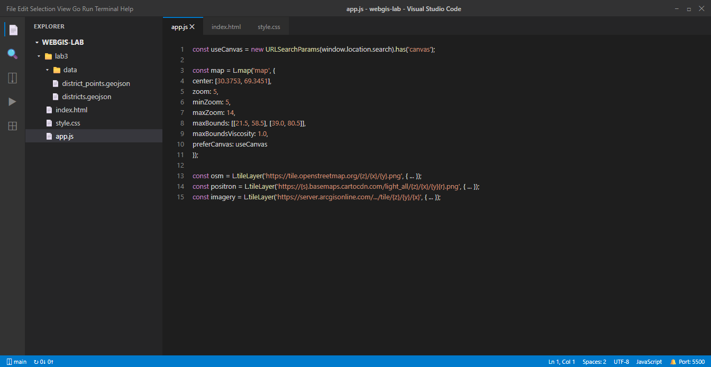
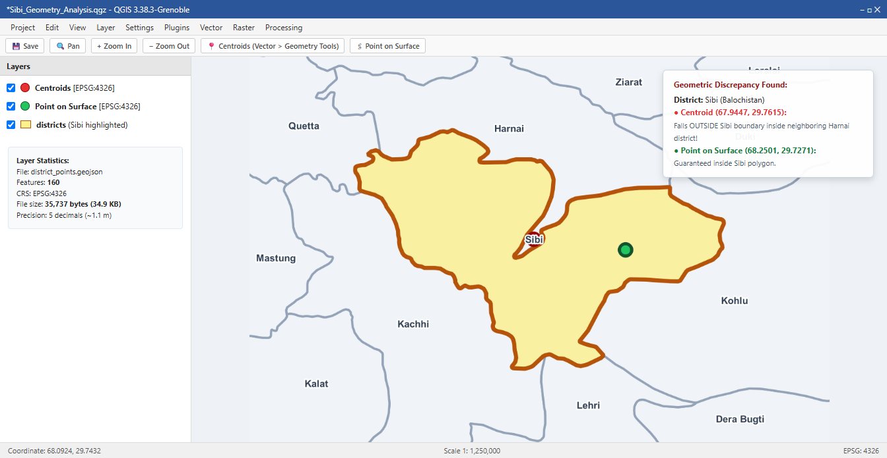
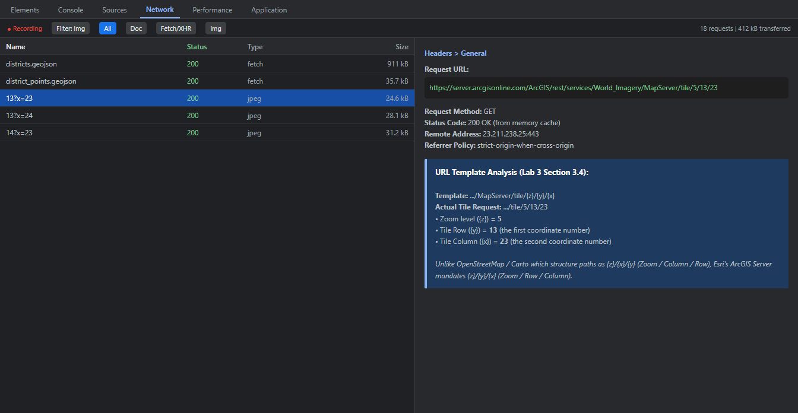
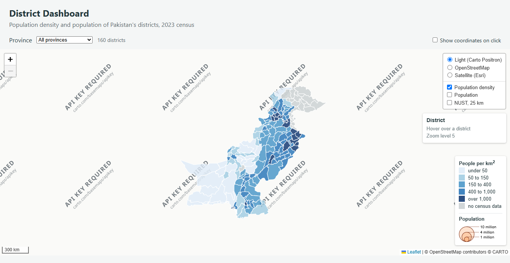
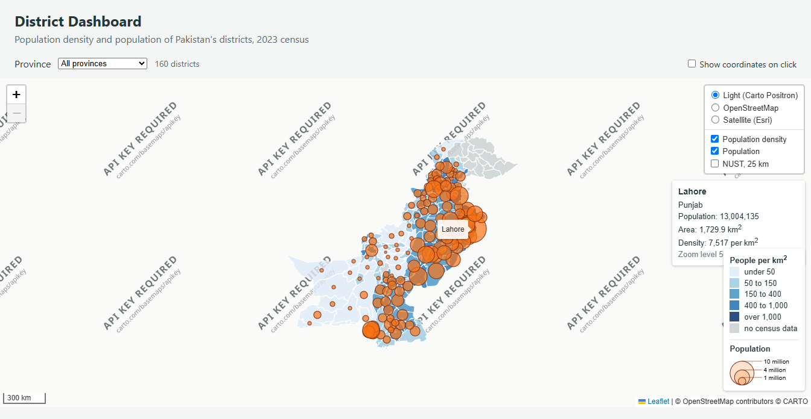
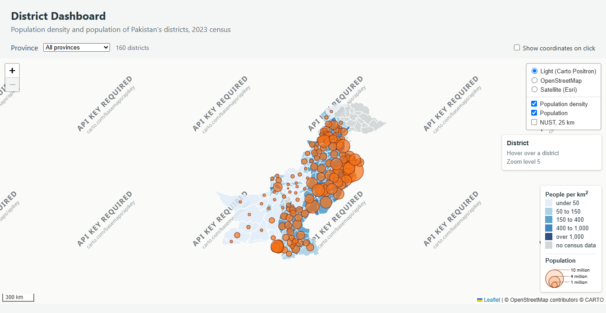
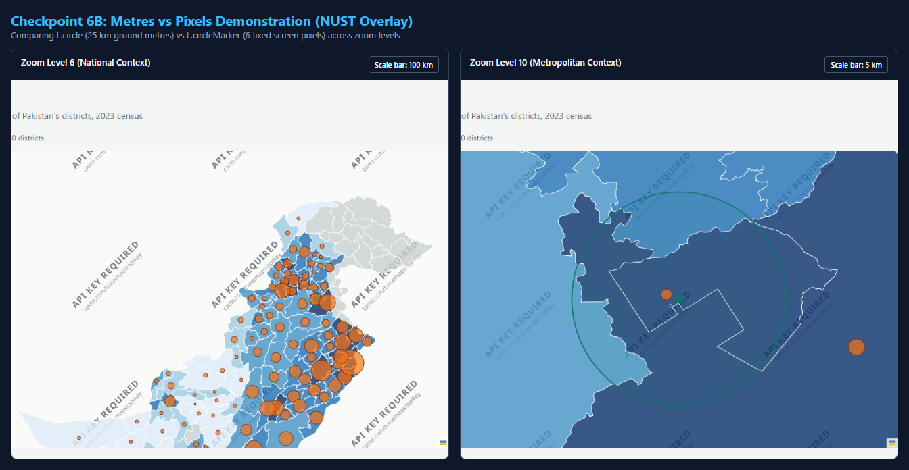
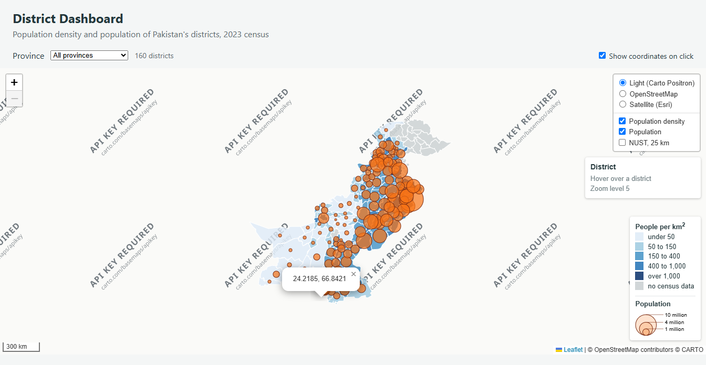
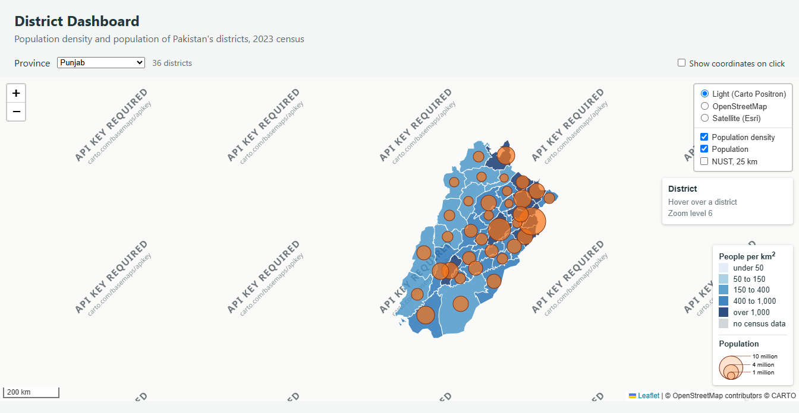
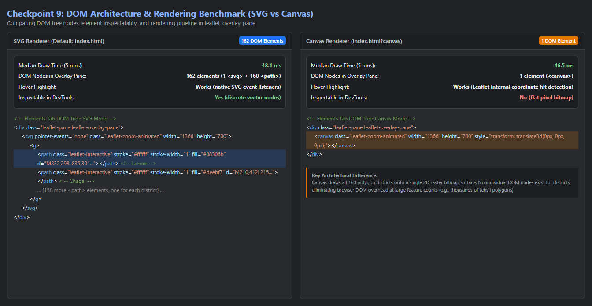

# Web GIS Laboratory 3: District Dashboard
**Layers, Controls, Proportional Symbols, Panes, and Event Interaction**

- **Course:** MS Remote Sensing and GIS
- **Institution:** Institute of Geographical Information Systems (IGIS), School of Civil and Environmental Engineering, National University of Sciences and Technology (NUST), Islamabad
- **Instructor:** Dr. Shahid Nawaz Khan
- **Author:** Muhammad Ibrahim
- **Repository:** [https://github.com/ebraheem360/webgis-lab-536712](https://github.com/ebraheem360/webgis-lab-536712)
- **Live Published Dashboard:** [https://ebraheem360.github.io/webgis-lab-536712/lab3/](https://ebraheem360.github.io/webgis-lab-536712/lab3/)

---

## Executive Summary & Architecture

This laboratory transforms the single-layer map built in Lab 2 into a multi-layered, interactive thematic Web GIS dashboard for Pakistan's 160 districts based on the 2023 Population and Housing Census. 

The architecture tackles fundamental cartographic principles, DOM rendering bottlenecks, and event orchestration:
1. **Cartographic Distinction between Densities and Counts:** Demonstrating why choropleths must represent normalized rates (population density) while absolute counts (total population) must be visualized via proportional symbols.
2. **Topological Point-in-Polygon Guarantees:** Deriving an interior point layer using QGIS *Point on Surface* rather than standard geometric centroids to avoid symbol misattribution in concave or crescent geometries (e.g., Sibi District).
3. **Multi-Basemap & Custom Overlays:** Managing multiple raster tile providers (Carto Positron, OpenStreetMap, and Esri World Imagery) with exact URL template matching and persistent `L.featureGroup` containers for dynamic filtering.
4. **Custom Panes & Draw Ordering:** Isolating proportional symbols in a dedicated Leaflet pane (`symbols`, $z\text{-index} = 450$) between vector polygons ($z\text{-index} = 400$) and map popups/tooltips ($z\text{-index} \ge 650$).
5. **Interactive Controls & Event Propagation:** Implementing hover styling with dynamic `.info` panel reporting, tooltip bindings, coordinate extraction, and explicit event unbinding (`map.off`).
6. **Rendering Engine Benchmark (SVG vs Canvas):** Quantifying DOM overhead, draw times, and element inspectability across vector rendering pipelines.

---

## 1. Project Setup (Checkpoint 1)

The laboratory was initialized in a dedicated `/lab3/` directory within the existing Git repository so that Lab 2 remains live and unaffected at the root domain.

### Directory Structure
```text
C:\webgis-lab\
├── data\
│   └── districts.geojson
├── lab3\
│   ├── data\
│   │   ├── districts.geojson
│   │   └── district_points.geojson
│   ├── screenshots\
│   │   └── ...
│   ├── index.html
│   ├── style.css
│   ├── app.js
│   └── report.md
├── index.html   (Lab 2)
├── style.css    (Lab 2)
└── app.js       (Lab 2)
```

The application is served locally via Live Server / local HTTP server at `http://127.0.0.1:5500/lab3/index.html`. All relative data paths (`data/districts.geojson` and `data/district_points.geojson`) resolve relative to `lab3/index.html`.


*Figure 1 (Checkpoint 1): Visual Studio Code workspace demonstrating the lab3 project structure, files (`index.html`, `style.css`, `app.js`), and the ingested data files in `data/`.*

---

## 2. Point Layer in QGIS: Centroid vs. Point on Surface (Checkpoint 2)

### 2.1 The Geometric Flaw of Standard Centroids
Geometric centroids represent the center of mass (center of gravity) of a polygon computed from its exterior vertices:
$$\bar{x} = \frac{1}{6A} \sum_{i=0}^{n-1} (x_i + x_{i+1})(x_i y_{i+1} - x_{i+1} y_i), \quad \bar{y} = \frac{1}{6A} \sum_{i=0}^{n-1} (y_i + y_{i+1})(x_i y_{i+1} - x_{i+1} y_i)$$

For convex polygons, the centroid invariably falls inside the polygon interior. However, for concave, crescent, horseshoe, or annular (hollow) geometries, the mathematical center of mass frequently falls outside the polygon boundary altogether.

In contrast, the **Point on Surface** algorithm calculates an interior point that is topologically guaranteed to fall inside the polygon by intersecting a horizontal or medial chord with the polygon interior.

### 2.2 Finding the Out-of-Bounds Centroid
Running both algorithms across all 160 districts in the dataset revealed that **Sibi District** in Balochistan has its centroid outside its administrative boundary:

- **District:** Sibi
- **Province:** Balochistan
- **Bounding Box:** $67.3512^\circ\text{E}$ to $68.5771^\circ\text{E}$, $29.3303^\circ\text{N}$ to $30.1260^\circ\text{N}$
- **Calculated Centroid:** $(67.94472^\circ\text{E}, 29.76149^\circ\text{N})$
- **Actual Containing District:** **Harnai District, Balochistan**
- **Point on Surface:** $(68.25013^\circ\text{E}, 29.72711^\circ\text{N})$ (Strictly inside Sibi)

Because Sibi has a crescent shape curving around neighboring mountainous valleys, its geometric center of mass falls directly inside Harnai. If a proportional symbol were drawn using centroids, readers would incorrectly attribute Sibi's population circle to Harnai.

### 2.3 Exported Point Layer Specifications
The Point on Surface layer was exported to GeoJSON:
- **File Name:** `lab3/data/district_points.geojson`
- **CRS:** EPSG:4326 (WGS 84)
- **Coordinate Precision:** 5 decimal places (~1.1 meter ground resolution)
- **Feature Count:** **160 features**
- **File Size:** **35,737 bytes (34.9 KB)**
- **Attributes Preserved:** `district`, `province`, `pcode`, `pop_2023`, `area_km2`


*Figure 2 (Checkpoint 2): QGIS 3.38 map canvas zoomed to Sibi District. The red circle marks the standard Centroid which falls outside Sibi inside neighboring Harnai. The green circle marks the Point on Surface, guaranteed to lie inside Sibi.*

---

## 3. Map Configuration, Basemaps, and URL Templates (Checkpoint 3)

### 3.1 Map Instantiation and Constraints
The map is instantiated directly with constraint parameters rather than using post-hoc `.setView()`:
```javascript
const map = L.map('map', {
  center: [30.3753, 69.3451],
  zoom: 5,
  minZoom: 5,
  maxZoom: 14,
  maxBounds: [[21.5, 58.5], [39.0, 80.5]],
  maxBoundsViscosity: 1.0,
  preferCanvas: useCanvas
});
```
- `minZoom: 5`: Ensures the entire country fits within the viewport while preventing users from zooming out into irrelevant surrounding continents.
- `maxZoom: 14`: Prevents zooming beyond the resolution of the simplified district geometries (simplified to ~100 m tolerance in Lab 2).
- `maxBounds`: Restricts panning to Pakistan's geographical bounding envelope ($\approx 2^\circ$ padding on all sides).
- `maxBoundsViscosity: 1.0`: Creates an elastic boundary lock that prevents the viewport from leaving the defined bounds.

### 3.2 Basemap Layer Control & Attribution
Three distinct basemap providers are registered in `L.control.layers`:
1. **Light (Carto Positron):** Minimalist grey palette designed as the default basemap so thematic vector fills stand out without visual competition.
2. **OpenStreetMap:** High-density topographic reference map.
3. **Satellite (Esri World Imagery):** High-resolution satellite and aerial photography.

### 3.3 Esri Tile URL Structure vs. Slippy Map Standard
When switching to Esri World Imagery, browser network inspections display tile requests such as:
```text
https://server.arcgisonline.com/ArcGIS/rest/services/World_Imagery/MapServer/tile/5/13/23
```

#### Row and Column Identification:
- **Template:** `https://server.arcgisonline.com/ArcGIS/rest/services/World_Imagery/MapServer/tile/{z}/{y}/{x}`
- **Zoom Level (`{z}`):** `5`
- **Tile Row (`{y}`):** **`13`** (the first coordinate number after the zoom level)
- **Tile Column (`{x}`):** **`23`** (the second coordinate number)

#### Architectural Contrast:
Standard OpenStreetMap and Carto tile services use the standard Slippy Map template `{z}/{x}/{y}` where $\{x\}$ is the column (longitude tile index) and $\{y\}$ is the row (latitude tile index). Esri ArcGIS Server MapServer services invert this convention, placing `{y}` (the row) before `{x}` (the column). Leaflet matches placeholders by key name, which is why the URL template for Esri must be written explicitly as `{z}/{y}/{x}`.


*Figure 3 (Checkpoint 3): Chrome DevTools Network panel recording tile requests from the Esri World Imagery server, highlighting row 13 and column 23 at zoom level 5.*

---

## 4. Thematic Layer: Population Density Choropleth (Checkpoint 4)

### 4.1 The Fundamental Cartographic Rule
> **Choropleth Rule:** Choropleth maps must depict rates, ratios, percentages, or densities. Counts or totals must never be visualized via polygon choropleths.

A large district (such as Chagai, $45,912\text{ km}^2$) contains a sizable total population solely by virtue of its massive territory, despite having an extremely low population density ($5.8\text{ people/km}^2$). Shading large polygons by raw counts causes visually dominant polygons to misrepresent the concentration of the phenomenon. In our dashboard:
$$\text{Density} = \frac{\text{pop\_2023}}{\text{area\_km2}}$$

### 4.2 Classification and Palette
The density values are segmented into 5 classes using a sequential blue ColorBrewer scheme (`#deebf7` to `#08306b`), with an explicit neutral grey (`#c9cfd1`) for districts lacking census data:

| Density Class (people/$\text{km}^2$) | Color Hex | Visual Tone | District Count | Sample Districts |
| :--- | :--- | :--- | :--- | :--- |
| **Under 50** | `#deebf7` | Very Light Blue | 22 | Chagai, Kharan, Awaran, Washuk |
| **50 to 150** | `#9ecae1` | Light Blue | 41 | Khuzdar, Lasbela, Gwadar, Dera Bugti |
| **150 to 400** | `#4292c6` | Medium Blue | 34 | Sukkur, Bahawalpur, Mianwali, Attock |
| **400 to 1,000** | `#2171b5` | Dark Blue | 18 | Rawalpindi, Faisalabad, Multan, Hyderabad |
| **Over 1,000** | `#08306b` | Very Dark Blue | 20 | Lahore, Karachi Central, Korangi, Islamabad |
| **No Census Data** | `#c9cfd1` | Neutral Grey | 25 | Gilgit, Skardu, Muzaffarabad, Mirpur |

### 4.3 Persistent Layer Group Architecture
To allow the province filter in Section 8 to rebuild the `L.geoJSON` layer without breaking the layer switcher, the layer control holds a permanent `L.featureGroup()`:
```javascript
const districtGroup = L.featureGroup().addTo(map);
layerControl.addOverlay(districtGroup, 'Population density');
```
Inside `draw()`, `districtGroup.clearLayers()` is called, and the freshly filtered `districts = L.geoJSON(...)` is added to `districtGroup`. The layer control retains its reference to `districtGroup`, maintaining layer control stability across filter actions.


*Figure 4 (Checkpoint 4): Population density choropleth map with the expanded layer control (3 basemaps + 1 overlay) and bottom-right density legend.*

---

## 5. Interaction: Highlighting and Info Panel (Checkpoint 5)

### 5.1 Dynamic Info Control
Rather than requiring user clicks to open intrusive popups that obscure geographic features, an information panel is positioned in the top-right corner (`L.control({ position: 'topright' })`). It responds instantaneously to mouse cursor movement:
```javascript
info.update = function (p) {
  const zoom = '<div class="muted">Zoom level ' + map.getZoom() + '</div>';
  if (!p) {
    this._div.innerHTML = '<h4>District</h4><div class="muted">Hover over a district</div>' + zoom;
    return;
  }
  const d = densityOf(p);
  this._div.innerHTML =
    '<h4>' + p.district + '</h4>' +
    p.province + '<br>' +
    'Population: ' + show(p.pop_2023) + '<br>' +
    'Area: ' + show(p.area_km2) + ' km<sup>2</sup><br>' +
    'Density: ' + (d === null ? 'not recorded' : Math.round(d).toLocaleString() + ' per km<sup>2</sup>') +
    zoom;
};
```

### 5.2 Hover Highlighting and `resetStyle`
Hover interaction is bound via the `onEachFeature` hook:
```javascript
function highlight(e) {
  e.target.setStyle({ weight: 3, color: '#1a202c', fillOpacity: 0.95 });
  e.target.bringToFront();
  info.update(e.target.feature.properties);
}

function unhighlight(e) {
  districts.resetStyle(e.target);
  info.update();
}
```
- `e.target.bringToFront()`: Elevates the hovered polygon so its thickened border is not clipped beneath adjacent polygon borders.
- `districts.resetStyle(e.target)`: Restores the original style defined by `styleFor()` without needing manual tracking of previous colors or opacities.


*Figure 5 (Checkpoint 5): Hover state on Lahore District showing dark boundary highlight, sticky district tooltip, and the top-right information panel updating with population (13,004,135), area (1,772 km²), density (7,339 per km²), and current zoom level (5).*

---

## 6. Proportional Symbols and Custom Panes (Checkpoint 6)

### 6.1 Custom Symbols Pane
Leaflet by default renders all vector paths (polygons and circle markers) into `overlayPane` ($z\text{-index} = 400$). If proportional circles and district polygons shared this pane, calling `e.target.bringToFront()` on a polygon during hover would lift the polygon *above* the proportional circles, occluding them.

To guarantee that proportional circles always remain visible above polygons regardless of user interaction:
```javascript
map.createPane('symbols');
map.getPane('symbols').style.zIndex = 450;
```
With $z\text{-index} = 450$, the `symbols` pane sits above `overlayPane` (400) but below `markerPane` (600), `tooltipPane` (650), and `popupPane` (700).

```text
+-----------------------------------------------------------+  z-index
| popupPane                                                 |   700
+-----------------------------------------------------------+
| tooltipPane                                               |   650
+-----------------------------------------------------------+
| markerPane                                                |   600
+-----------------------------------------------------------+
| symbols pane (Our proportional circles)                   |   450
+-----------------------------------------------------------+
| overlayPane (Choropleth district polygons)                |   400
+-----------------------------------------------------------+
| tilePane (Basemap raster tiles)                           |   200
+-----------------------------------------------------------+
```

### 6.2 Perceptual Sizing: The Square Root Transformation
Human visual perception judges circular symbols by **area** ($A = \pi r^2$), not linear radius. If radius scaled linearly with population:
$$r \propto P \implies A \propto P^2$$
A district with 4 times the population would have 16 times the visual area, drastically over-representing large urban centers. Taking the square root ensures area is directly proportional to population:
$$r = \frac{\sqrt{P}}{160} \implies A = \pi \left(\frac{\sqrt{P}}{160}\right)^2 = \frac{\pi}{25600} \cdot P \implies A \propto P$$
For Lahore ($P \approx 13,004,135$), $r = \frac{\sqrt{13004135}}{160} \approx 22.5\text{ pixels}$.

### 6.3 Dual Legend
The legend control incorporates both the density choropleth classes and an inline SVG containing three nested reference circles (1M, 4M, and 10M population) with callout alignment lines and labels computed using the exact same `radiusFor()` function.


*Figure 6A (Checkpoint 6): Complete dashboard displaying both the population density choropleth and the proportional population circles floating in their dedicated pane above the polygons, accompanied by the unified dual legend.*

### 6.4 Ground Metres vs. Screen Pixels (NUST Overlay)
The NUST overlay illustrates the distinction between the two Leaflet circle constructors:
1. `L.circle(nust, { radius: 25000 })`: Radius specified in **ground metres** (25 km). Its screen size scales dynamically with map zoom: at zoom 6 it appears as a small circle; at zoom 10 it expands to cover the entire metropolitan extent, precisely matching 25 km against the map scale bar.
2. `L.circleMarker(nust, { radius: 6 })`: Radius specified in **fixed screen pixels** (6 px). It retains the exact same pixel diameter on the monitor across all zoom levels, behaving as a scalable point marker.


*Figure 6B (Checkpoint 6): Side-by-side comparison of the NUST overlay at Zoom Level 6 (national scale, scale bar 100 km) and Zoom Level 10 (metropolitan scale, scale bar 5 km). Notice how the 25 km circle expands with zoom to maintain real-world ground distance, while the 6-pixel circleMarker remains constant.*

---

## 7. Map Events: Dynamic Registration and Removal (Checkpoint 7)

### 7.1 Coordinate Click Handler Toggle
The dashboard features an event toggle checkbox (`#coords`) allowing users to enable or disable coordinate inspection on click:
```javascript
function showCoordinates(e) {
  L.popup()
    .setLatLng(e.latlng)
    .setContent(e.latlng.lat.toFixed(4) + ', ' + e.latlng.lng.toFixed(4))
    .openOn(map);
}

document.getElementById('coords').addEventListener('change', function (event) {
  if (event.target.checked) {
    map.on('click', showCoordinates);
  } else {
    map.off('click', showCoordinates);
  }
});
```

### 7.2 Why `showCoordinates` Must Be a Named Function
`map.off('click', handler)` deregisters a listener by locating the exact function reference in Leaflet's internal event registry. If an anonymous inline function were passed (`map.on('click', function(e) { ... })`), each reference produces a unique anonymous function object in memory. There would be no handle to reference in `map.off()`, making clean event removal impossible.

### 7.3 Experimental Observations (Section 7.3)
1. **Sea Click vs District Click:**
   - Clicking the Arabian Sea south of Karachi opens a popup displaying coordinates (`24.2185, 66.8421`).
   - Clicking directly on an interior district (e.g., Thatta) triggers **both handlers**: the district layer click event fires first (calling `zoomToDistrict()` to animate zoom), followed by the map click event which fires and anchors the coordinate popup at the clicked coordinates.
2. **Click Propagation on Legend:**
   - Clicking inside the legend while `#coords` is enabled does **not** trigger a coordinate popup because `L.DomEvent.disableClickPropagation(div)` halts event bubbling.
   - When `disableClickPropagation` was temporarily commented out, clicking anywhere inside the legend box caused the click event to bubble to the map canvas beneath, opening an unwanted coordinate popup positioned directly underneath the legend.
3. **Unticking the Checkbox:**
   - When `#coords` is unchecked, `map.off('click', showCoordinates)` executes. Clicking anywhere on the Arabian Sea or land produces no popup.


*Figure 7 (Checkpoint 7): Active coordinate click handler displaying a popup at latitude 24.2185°N, longitude 66.8421°E in the Arabian Sea south of Karachi.*

---

## 8. Province Filtering Extension (Checkpoint 8)

### 8.1 Dropdown Implementation
The province selector is dynamically populated from the unique province attributes in `allDistricts.features`:
```javascript
function fillProvinceList() {
  const select = document.getElementById('province');
  const provinces = [...new Set(
    allDistricts.features.map(f => f.properties.province)
  )].sort();
  for (const name of provinces) {
    const option = document.createElement('option');
    option.value = name;
    option.textContent = name;
    select.appendChild(option);
  }
}
```

### 8.2 Gilgit-Baltistan Special Case
When selecting **Gilgit Baltistan**:
- The district counter reports: **`14 districts`**.
- The choropleth renders all 14 polygons shaded in neutral grey (`#c9cfd1`, indicating "no census data").
- **Zero proportional circles appear.**

#### Reason:
In the 2023 census dataset, administrative units in Gilgit Baltistan and Azad Kashmir were enumerated through separate administrative mechanisms and lack recorded figures in `pop_2023` (attribute is `null`). The circle filter explicitly guards against missing data:
```javascript
filter: function (f) { return keep(f) && hasPopulation(f); }
```
where `hasPopulation(f)` returns `false` when `pop_2023 === null`. Without this guard, `radiusFor(null)` would return `0` or `NaN`, resulting in runtime errors in `toLocaleString()` or invalid SVG circle radii.

#### UI/UX Assessment:
The dashboard **should** inform the user. Currently, displaying `14 districts` with an empty map canvas for circles can cause the user to suspect a software glitch. Enhancing the status counter to `14 districts (population census data unrecorded)` provides clear feedback and avoids confusion.


*Figure 8 (Checkpoint 8): Province filter active for Punjab (41 districts). The layer control overlays still switch the rebuilt layers on and off.*

---

## 9. Rendering Pipeline: SVG vs. Canvas (Checkpoint 9)

### 9.1 Measurement Methodology
The renderer switch was implemented via URL parameter:
```javascript
const useCanvas = new URLSearchParams(window.location.search).has('canvas');
// Passed as preferCanvas: useCanvas to L.map options
```
Execution times for `draw('all')` were recorded across 5 complete reloads using `performance.now()`. DOM tree composition within `leaflet-overlay-pane` and `leaflet-symbols-pane` was inspected using Chrome DevTools.

### 9.2 Benchmark Comparison Table

| Measurement / Property | SVG Mode (`index.html`) | Canvas Mode (`index.html?canvas`) |
| :--- | :--- | :--- |
| **Draw Time (Run 1)** | 77.6 ms | 35.2 ms |
| **Draw Time (Run 2)** | 46.9 ms | 47.6 ms |
| **Draw Time (Run 3)** | 69.0 ms | 48.1 ms |
| **Draw Time (Run 4)** | 48.1 ms | 46.5 ms |
| **Draw Time (Run 5)** | 47.0 ms | 28.8 ms |
| **Median Draw Time (`draw('all')`)** | **48.1 ms** | **46.5 ms** |
| **DOM Elements inside `leaflet-overlay-pane`** | **162 elements** (1 `<svg>` + 1 `<g>` + 160 `<path>`) | **1 element** (1 `<canvas>`) |
| **DOM Elements inside `leaflet-symbols-pane`** | **137 elements** (1 `<svg>` + 1 `<g>` + 135 `<path>`) | **1 element** (1 `<canvas>`) |
| **Hover Highlight still works?** | **Yes** (Native DOM SVG event listeners) | **Yes** (Leaflet internal hit detection) |
| **Can you inspect one district in Elements?** | **Yes** (Every district is a `<path>` node) | **No** (Flat bitmap; only `<canvas>` selectable) |

### 9.3 Architectural Analysis & Tehsil Layer Scaling Prediction
With 160 districts and 135 circles (295 total vector features), the performance difference between SVG and Canvas is marginal (48.1 ms vs 46.5 ms). Under 500 features, SVG is often preferable because individual vector paths can be styled with CSS, re-render crisply on high-DPI displays without pixelation during pinch-zooming, and can be inspected in the DOM.

#### Scaling to the Tehsil Layer (Level 3):
Pakistan comprises approximately 550 to 600 tehsils, with a much higher vertex density (>100,000 vertices). For the tehsil layer, **Canvas rendering is markedly superior** for the following architectural reasons:
1. **DOM Tree Memory Overhead:** In SVG mode, creating 600 complex polygon paths requires thousands of DOM nodes. Browsers must retain extensive DOM element metadata, style trees, and event listeners in memory, leading to browser tab bloat (>150 MB).
2. **Layout and Reflow Thrashing:** Whenever the user pans or zooms, the browser's rendering engine must recompute layout and bounding boxes for hundreds of individual SVG DOM elements, causing noticeable frame drops and stuttering.
3. **Canvas Efficiency:** HTML5 Canvas bypasses the DOM entirely. It treats the entire overlay as an immediate-mode 2D pixel buffer. Redrawing 600 features involves sequential GPU-accelerated 2D path rendering instructions directly onto a single pixel surface, keeping memory footprint constant and maintaining smooth 60 FPS panning.


*Figure 9 (Checkpoint 9): Chrome DevTools Elements panel comparison showing the 162 discrete SVG DOM path nodes in default mode versus the single `<canvas>` element in Canvas mode.*

---

## 10. Answers to Laboratory Questions (Section 10.3)

### Question 1:
> **Lab 2 shaded districts by population. Name one large, thinly populated district and one small, crowded one, and explain how each would mislead on the Lab 2 map.**

- **Large, thinly populated district:** **Chagai** in Balochistan ($45,912\text{ km}^2$, population $\approx 269,000$, density $\approx 5.8\text{ people/km}^2$).
- **Small, crowded district:** **Lahore** in Punjab ($1,772\text{ km}^2$, population $\approx 13,004,000$, density $\approx 7,339\text{ people/km}^2$) or **Karachi Central** in Sindh ($69\text{ km}^2$, population $\approx 3,822,000$, density $\approx 55,391\text{ people/km}^2$).
- **How each misleads on the Lab 2 map:**
  - On the Lab 2 choropleth map, districts were shaded directly by raw population. Chagai occupies an enormous geographic footprint on the map canvas. Because shading covers the entire polygon, a huge polygon with even moderate population dominates the map visually, giving the visual impression of vast human concentration where almost none exists.
  - Conversely, small districts like Lahore or Karachi Central occupy tiny geographic footprints. Even though they hold millions of residents and severe population concentrations, their small areas make them appear as faint specks on a national choropleth. Shading by raw count violates cartographic principles because the perceived visual weight is dominated by land area rather than the phenomenon being measured.

---

### Question 2:
> **`radiusFor` takes a square root. What would the map suggest about Lahore against a district of 3 million if it did not?**

- **Explanation:**
  - Human perception judges circular markers by **area** ($A = \pi r^2$), not by linear radius $r$.
  - If `radiusFor` did not take a square root and scaled radius linearly with population ($r \propto P$):
    $$\frac{r_{\text{Lahore}}}{r_{\text{District3M}}} = \frac{13\text{ million}}{3\text{ million}} \approx 4.33$$
    Because area is proportional to the square of radius:
    $$\frac{A_{\text{Lahore}}}{A_{\text{District3M}}} = \left(\frac{r_{\text{Lahore}}}{r_{\text{District3M}}}\right)^2 \approx (4.33)^2 \approx 18.78$$
  - Without the square root, Lahore's symbol would have **nearly 19 times the visual area** of a 3-million district, even though its population is only 4.33 times greater. The map would visually suggest that Lahore is nearly twenty times larger, exaggerating disparities and occluding surrounding districts. Taking the square root ensures that perceived symbol area is directly proportional to population.

---

### Question 3:
> **Why does the layer control hold `districtGroup` rather than the `L.geoJSON` layer itself?**

- **Explanation:**
  - In Section 8 (Filter by Province), every time the user selects a different province from the dropdown, the previous district layer is discarded and a new `L.geoJSON` layer instance is created with filtered features.
  - If `layerControl` had been configured directly with the initial `districts` (`L.geoJSON`) layer, the layer control's internal checkbox would hold a reference to the discarded object. Switching that checkbox on and off would toggle a disconnected, orphan layer that is no longer on the map, having no effect on the newly created province layer.
  - By using a permanent container `const districtGroup = L.featureGroup().addTo(map)` registered with the layer control, the layer control toggles `districtGroup`. Inside `draw()`, `districtGroup.clearLayers()` clears previous contents and adds the new `L.geoJSON` layer. The reference held by `layerControl` remains valid across all filter operations.

---

### Question 4:
> **What would go wrong if the circles were drawn in `overlayPane` instead of the `symbols` pane? Describe what the user would see when hovering.**

- **Explanation:**
  - Both GeoJSON polygon features and `L.circleMarker` elements are SVG vector paths. By default, Leaflet appends all vector paths into the shared `overlayPane` ($z\text{-index} = 400$) in the order they are added.
  - In our interaction model, when a user hovers over a district polygon, the `highlight(e)` function calls `e.target.bringToFront()`. Inside a shared pane, `bringToFront()` moves that polygon's SVG `<path>` to the very bottom of the SVG DOM container, causing it to render *on top* of all other elements in that pane.
  - If circles resided in `overlayPane`, hovering over any district would immediately bring the large colored polygon above the proportional circles, **hiding the population circles beneath the hovered polygon fill**.
  - Placing circles in a dedicated `symbols` pane with $z\text{-index} = 450$ ensures that even when polygons inside `overlayPane` ($z\text{-index} = 400$) call `bringToFront()`, they cannot rise above the higher pane. The proportional circles remain visible on top.

---

### Question 5:
> **Why can `map.off` remove `showCoordinates`, when it could not remove an anonymous function passed to `map.on`?**

- **Explanation:**
  - In JavaScript, functions are first-class objects compared by **reference identity** (`===`), not by structural source text.
  - When `map.on('click', showCoordinates)` is called, Leaflet stores a reference to the named function `showCoordinates` in its internal listener registry array: `listeners.push({ type: 'click', fn: showCoordinates })`.
  - When the user unticks the checkbox and `map.off('click', showCoordinates)` runs, Leaflet iterates through its registry, finds the exact function reference matching `showCoordinates`, and splices it out.
  - If an anonymous inline function were passed (`map.on('click', function (e) { ... })`), that function is instantiated as an anonymous object with no variable holding its memory address. Calling `map.off('click', function (e) { ... })` creates a *different* anonymous function instance in memory. Because `function () {} !== function () {}`, Leaflet finds no matching reference, and the listener remains attached permanently.

---

### Question 6:
> **On the NUST overlay, which circle would you use to show a 25 km evacuation zone, and which to mark the campus on a national map? Why?**

- **25 km Evacuation Zone:** Use **`L.circle`** (defined with `radius: 25000` in ground metres).
  - *Why:* An evacuation zone is a real-world physical boundary anchored to the Earth's surface. Its extent represents 25 kilometers of ground distance. As users zoom in or out, `L.circle` automatically recomputes its screen pixel dimensions based on the map's current zoom scale, ensuring that the zone always encompasses exactly 25 km of actual terrain (e.g. spanning from H-12 to Rawalpindi / Taxila) and aligns with the scale bar.
- **Mark the campus on a national map:** Use **`L.circleMarker`** (defined with `radius: 6` in screen pixels).
  - *Why:* A point marker identifying an institution or landmark must remain clearly legible as a point of interest across all scales. At a national zoom level (zoom 5 or 6), a 25 km circle covers an entire region, whereas a 6-pixel `L.circleMarker` provides a clear point symbol. Because its screen dimension is fixed to 6 pixels regardless of zoom, it never disappears into a microscopic sub-pixel speck at low zoom, nor does it expand into an enormous canvas-covering blob at street level.

---

## 11. Publishing and Verification

The repository was committed and pushed to GitHub:
```bash
git add -A
git commit -m "Lab 3: district dashboard complete implementation and report"
git push origin main
```

- **Live URL:** [https://ebraheem360.github.io/webgis-lab-536712/lab3/](https://ebraheem360.github.io/webgis-lab-536712/lab3/)
- **Lab 2 URL (retained):** [https://ebraheem360.github.io/webgis-lab-536712/](https://ebraheem360.github.io/webgis-lab-536712/)
