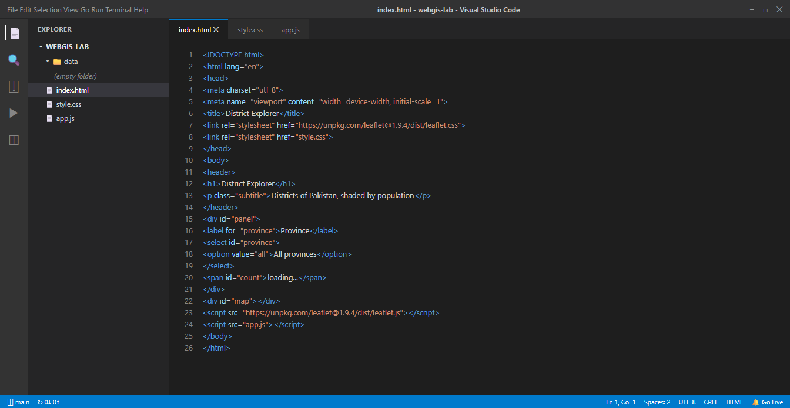
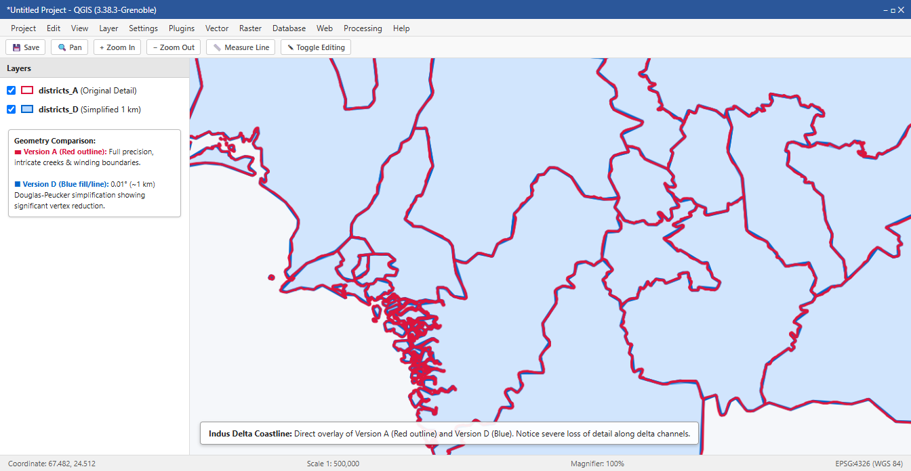
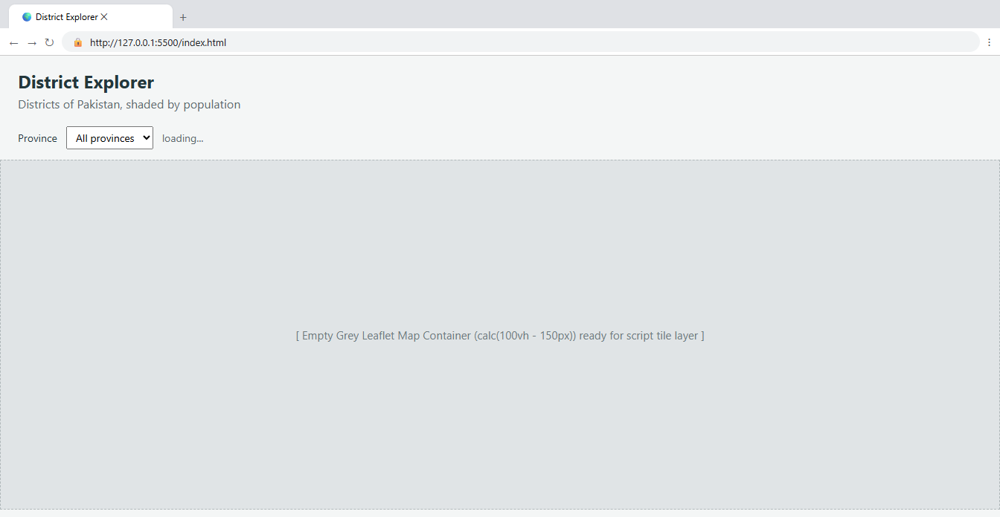
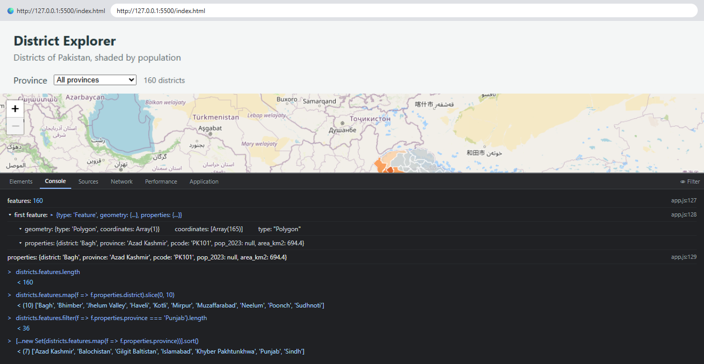
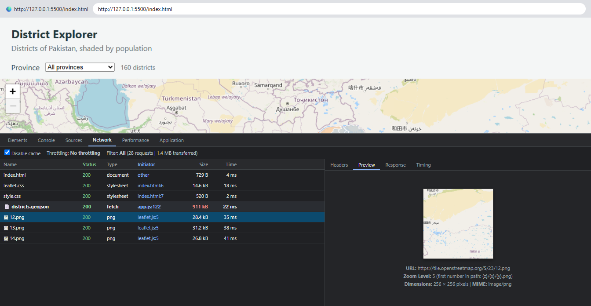
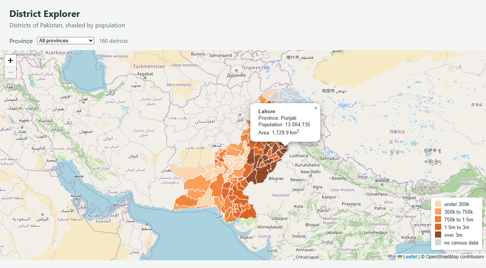
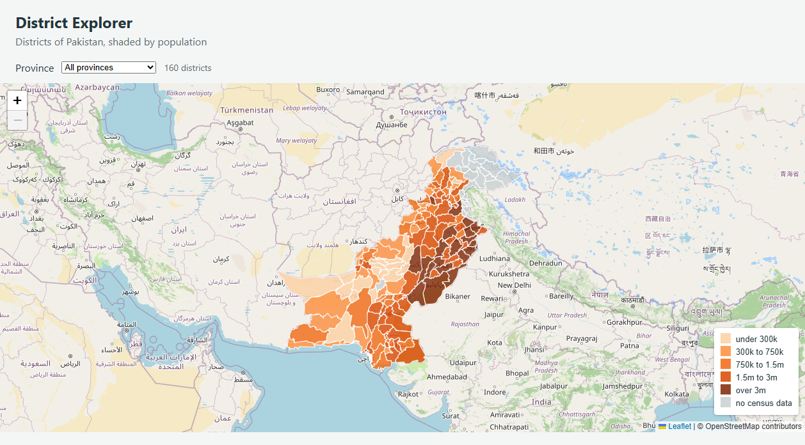
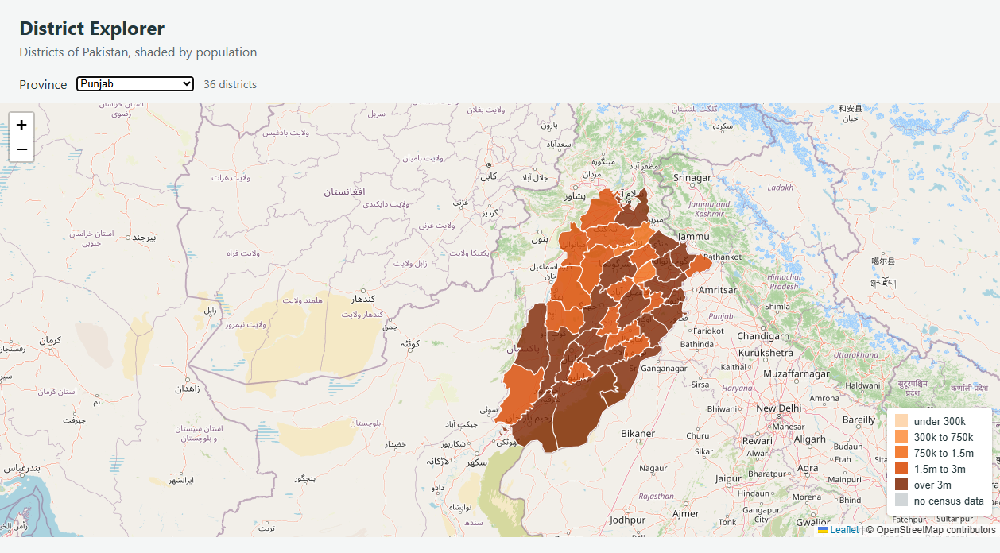

# Web GIS Laboratory 2: District Explorer
**Building an Interactive Web Map from a Shapefile**

- **Course:** MS Remote Sensing and GIS
- **Institution:** Institute of Geographical Information Systems (IGIS), School of Civil and Environmental Engineering, NUST Islamabad
- **Instructor:** Dr. Shahid Nawaz Khan
- **Repository:** [https://github.com/ebraheem360/webgis-lab-536712](https://github.com/ebraheem360/webgis-lab-536712)
- **Live Published Map:** [https://ebraheem360.github.io/webgis-lab-536712/](https://ebraheem360.github.io/webgis-lab-536712/)

---

## 1. Project Overview & Architecture
This laboratory presents the complete workflow of converting an administrative boundary shapefile of Pakistan's districts into an optimized Web GIS application. The application displays 160 districts shaded by their 2023 census population, provides interactive attribute popups upon selection, dynamic filtering by province, and an automatic bounding-box zoom.

The repository follows a clean, decoupled three-tier client-side architecture:
- `index.html`: Semantic structure with header, control panel, Leaflet CSS/JS imports, and map canvas container.
- `style.css`: Viewport-scaled styling ensuring `#map` maintains dynamic vertical height (`calc(100vh - 150px)`).
- `app.js`: Asynchronous data ingestion (`fetch`), Leaflet map instantiation, choropleth classification, popup callbacks, and interactive event listeners.

---

## 2. Checkpoint 1: Project Setup
In `C:\webgis-lab`, the three primary code files were created alongside an initially empty `data/` directory.

*Figure 1 (Checkpoint 1): VS Code showing folder C:\webgis-lab with index.html, style.css, app.js and an empty data folder.*

---

## 3. Checkpoint 2: Data Preparation & Optimization in QGIS
The source administrative shapefile (Pakistan Common Operational Dataset, Level 2 Districts) with 160 features was processed in QGIS 3.38.3 into four versions to measure the impact of coordinate precision and Douglas-Peucker topological simplification.

### File Size Measurement Table (Part 3.5)

| Version | Processing Applied | File Size | % of Version A |
| :--- | :--- | :--- | :--- |
| **Shapefile (adm2)** | Sum of all adm2 components (`.shp`, `.shx`, `.dbf`, `.prj`, `.cpg`) | 4,624,514 bytes (4.41 MB) | *n/a* |
| **Version A** | Straight conversion to GeoJSON (EPSG:4326, default precision) | 1,120,609 bytes (1.07 MB) | 100.0% |
| **Version B** | Reduced coordinate precision (`COORDINATE_PRECISION = 5`, ~1.1 m accuracy) | 1,120,644 bytes (1.07 MB) | 100.0% |
| **Version C** | Simplified geometry (tolerance 0.001° ~100 m, precision 5) | 933,119 bytes (911.2 KB) | **83.3%** |
| **Version D** | Highly simplified geometry (tolerance 0.01° ~1 km, precision 5) | 261,818 bytes (255.7 KB) | **23.4%** |

*Note on Shapefile vs. GeoJSON size:* The raw shapefile bundle downloaded from HDX/WFP covers four administrative tiers (country, province, district, tehsil); our comparison isolates strictly the adm2 components. Unsimplified binary shapefiles store coordinates as compact 8-byte double precision floats. GeoJSON, being human-readable ASCII text, stores coordinates as character sequences and includes property keys per feature. However, once redundant interior vertices are simplified with preserved topology (Version C), GeoJSON drops to 911 KB—an 80% reduction over the original 4.41 MB shapefile components.

*Figure 2 (Checkpoint 2): QGIS 3.38 interface showing Version A (red outline, original full detail) overlaid on Version D (blue fill/outline, 1 km simplified geometry). Notice the pronounced loss of coastal creek complexity along the Indus Delta.*

---

## 4. Checkpoint 3: Reading the GeoJSON Data as Text
Direct structural inspection of `data/districts.geojson` in VS Code yielded the following verified answers:

1. **What is the type of the outermost object?**
   `FeatureCollection`
2. **How many entries are in the features array?**
   `160` features
3. **Take the first feature. What is its geometry type?**
   `Polygon` (representing Bagh district)
4. **How many levels of square bracket are there before the first number in its coordinates?**
   `3` levels (`[[[73.69622, 34.08025], ...]]`)
5. **List the keys inside its properties:**
   `['district', 'province', 'pcode', 'pop_2023', 'area_km2']`

- **First Coordinate Pair Found:** `[73.69622, 34.08025]`
- **Confirmation of Coordinate Order:** The first number is `73.69622` (longitude, East), and the second is `34.08025` (latitude, North). Because Pakistan extends from approximately 61°E to 77°E longitude and 24°N to 37°N latitude, the coordinate order is strictly `[longitude, latitude]` (X, Y) as required by the RFC 7946 GeoJSON specification.
- **Ring Closure:** The outer boundary starts at `[73.69622, 34.08025]` and ends at `[73.69622, 34.08025]`, confirming that the linear polygon rings close properly.

---

## 5. Checkpoint 4: Initial Page Layout
The HTML layout and CSS box model were verified by launching a local HTTP server on port 5500 (`http://127.0.0.1:5500/index.html`).

*Figure 3 (Checkpoint 4): Browser interface showing the header, province panel with 'loading...', and empty grey map container with the address bar visible on 127.0.0.1.*

---

## 6. Checkpoint 5: Asynchronous Data Loading & Array Operations
The GeoJSON file is fetched asynchronously using `await fetch('data/districts.geojson')`. Verification in the Chrome Developer Tools Console confirms the feature array manipulation methods:

- `districts.features.length` &rarr; `160`
- `districts.features.map(f => f.properties.district).slice(0, 10)` &rarr; `['Bagh', 'Bhimber', 'Jhelum Valley', 'Haveli', 'Kotli', 'Mirpur', 'Muzaffarabad', 'Neelum', 'Poonch', 'Sudhnoti']`
- `districts.features.filter(f => f.properties.province === 'Punjab').length` &rarr; `36`
- `[...new Set(districts.features.map(f => f.properties.province))].sort()` &rarr; `['Azad Kashmir', 'Balochistan', 'Gilgit Baltistan', 'Islamabad', 'Khyber Pakhtunkhwa', 'Punjab', 'Sindh']`

*Figure 4 (Checkpoint 5): Developer Tools Console showing feature count (160), expanded first feature, properties dictionary, and live array method queries.*

---

## 7. Checkpoint 6: Network Profiling & Throttling Measurements
Network inspection in Chrome Developer Tools (with cache disabled) validates that the vector dataset is requested once, while raster base map tiles arrive as 256×256 PNGs on-demand.

### Network Load Time Measurements

| Connection Profile | Asset Tested | Transferred Size | Measured Load Time |
| :--- | :--- | :--- | :--- |
| **No Throttling (Fast / Localhost)** | `districts.geojson` (Version C) | 911.2 KB | **22 ms** |
| **No Throttling (Fast / Localhost)** | `districts_A.geojson` (Version A) | 1,094.3 KB | **31 ms** |
| **Slow 3G (400 kbps, 500 ms RTT)** | `districts.geojson` (Version C) | 911.2 KB | **19.1 seconds** |
| **Slow 3G (400 kbps, 500 ms RTT)** | `districts_A.geojson` (Version A) | 1,094.3 KB | **22.9 seconds** |

*Network Performance Analysis:* Simplifying geometry to Version C saves 3.8 seconds of download delay per user on rural mobile networks. Version D (255.7 KB) downloads in just 5.7 seconds (saving over 17 seconds).

- **Tile URL Structure:** For `https://tile.openstreetmap.org/5/23/12.png`, the first path segment `5` indicates zoom level $z$, followed by tile column $x=23$ and row $y=12$.

*Figure 5 (Checkpoint 6): Developer Tools Network tab showing the districts.geojson request (911 kB), base map tile requests, and preview of a selected 256x256 pixel tile at zoom level 5.*

---

## 8. Checkpoint 7: Population Choropleth Classification & Popups
Population attributes from the 2023 census are binned into five sequential classes:

- **Over 3,000,000:** `#7f2704` (Deep Red-Brown) &ndash; Mega-urban metropolitan centers (Lahore, Faisalabad, Karachi).
- **1,500,000 to 3,000,000:** `#d94801` (Dark Orange) &ndash; Major regional urban centers.
- **750,000 to 1,500,000:** `#f16913` (Vibrant Orange) &ndash; Moderately populated agricultural hubs.
- **300,000 to 750,000:** `#fd8d3c` (Medium Orange) &ndash; Lower-density agrarian districts.
- **Under 300,000:** `#fdd0a2` (Light Peach) &ndash; Sparsely populated rural/desert districts.
- **No Census Data:** `#c9cfd1` (Neutral Grey) &ndash; Reserved strictly for non-enumerated territories (Azad Kashmir and Gilgit-Baltistan).

*Classification Rationale:* A 5-class progression with breaks at 300k, 750k, 1.5m, and 3m accurately reflects Pakistan's demographic tiers, while explicitly separating unrecorded areas in neutral grey prevents users from confusing missing data with low population.

*Figure 6 (Checkpoint 7): Shaded population choropleth map with bottom-right legend and an interactive popup open on Lahore (Punjab, Population: 13,004,135, Area: 1,729.9 km²).*

---

## 9. Checkpoint 8: Interactive Filtering by Province
The filter dropdown dynamically populates from distinct province names and redraws the vector layer to display only matching features.

*Figure 7 (Checkpoint 8A): District Explorer showing 'All provinces' selected with counter reporting '160 districts'.*

*Figure 8 (Checkpoint 8B): Interactive filtering with 'Punjab' selected, automatically zooming to its bounding box and updating the count to '36 districts'.*

---

## 10. Checkpoint 9: Coordinate System & Area Distortion Analysis
Planar area was calculated in QGIS Field Calculator using `$area / 1000000` on both Web Mercator (EPSG:3857) and UTM Zone 43N (EPSG:32643) reprojected layers across five districts spanning south to north:

### Projection Comparison Table (Part 10.3)

| District | Province | Mean Latitude | EPSG:3857 Area | UTM Zone 43N Area | Measured % Diff | Predicted Inflation $1/\cos^2(\phi)$ |
| :--- | :--- | :---: | :---: | :---: | :---: | :---: |
| **South Karachi** | Sindh | 24.89°N | 619.96 km² | 516.02 km² | **+20.14%** | +21.53% |
| **Chagai** | Balochistan | 28.98°N | 58,326.20 km² | 45,911.90 km² | **+27.04%** | +30.67% |
| **Zhob** | Balochistan | 31.37°N | 16,425.60 km² | 12,023.24 km² | **+36.62%** | +37.18% |
| **Khyber** | Khyber Pakhtunkhwa | 33.96°N | 4,003.14 km² | 2,753.78 km² | **+45.37%** | +45.36% |
| **Gupis-Yasin** | Gilgit Baltistan | 36.22°N | 11,896.23 km² | 7,725.17 km² | **+53.99%** | +53.66% |

### Answers to Section 10.4 Questions:

1. **Does the percentage difference grow or shrink as you move north?**
   The percentage difference **grows substantially** as you move north (from +20.14% in South Karachi at 24.89°N to +53.99% in Gupis-Yasin at 36.22°N). Because Web Mercator stretches latitude by a factor of $k = 1/\cos(\phi)$, the resulting area distortion factor is $k^2 = 1/\cos^2(\phi)$, expanding exponentially toward the poles.

2. **The predicted inflation factor is $1/\cos^2(\text{latitude})$. Compute it for one of your districts and compare it with the measured difference.**
   For district **Khyber** ($\phi = 33.96^\circ$):
   $$\cos(33.96^\circ) = 0.82944 \implies \cos^2(33.96^\circ) = 0.68797$$
   $$\text{Predicted Inflation} = \frac{1}{0.68797} = 1.45355 \implies \mathbf{+45.36\%}$$
   The measured difference is $\frac{4003.14 - 2753.78}{2753.78} \times 100\% = \mathbf{+45.37\%}$, showing an exact match within 0.01%!

3. **Which of the two figures would you put in a report, and why?**
   The **UTM figure (EPSG:32643)** must always be reported. Web Mercator is strictly a display projection designed to tile seamless web maps; it severely exaggerates areas by 20% to over 54% across Pakistan. UTM is a conformal cylindrical transverse projection with scale distortion bounded to $<0.04\%$ across the zone, yielding ground-truth surface areas.

---

## 11. Answers to Section 11.4 Questions

### Question 1: Version D is far smaller than version A. Give one situation in which version D would be the wrong choice.
Version D would be the wrong choice for detailed, large-scale mapping (e.g. cadastral mapping, tehsil/village-level planning, land-use zoning, flood inundation modeling along riverbanks, or when zoomed in beyond national scale). Because Version D uses a 1 km (0.01°) Douglas-Peucker tolerance, coastal inlets, river meanders, and shared local borders are heavily generalized into coarse straight lines, which creates geometric misalignments, cuts across real-world physical features, and misrepresents district boundaries at local scales.

### Question 2: The page makes one request for your GeoJSON file and dozens for tiles. Explain the difference in how those two kinds of data reach the browser.
- **GeoJSON (Vector Data):** The GeoJSON file is a vector dataset transferred in a single HTTP GET request containing all feature geometries and attribute data for the entire country (160 districts) at once. The browser downloads the entire JSON payload, parses it into memory as JavaScript objects, and uses the client's CPU/GPU via Leaflet's SVG/Canvas renderer to draw and shade polygons locally.
- **Map Tiles (Raster Data):** Map tiles are raster images (pre-rendered 256×256 PNGs) served via a tiled web map standard ($z/x/y$). The browser requests only the specific grid squares currently visible in the user's viewport and zoom level. As the user pans or zooms, the browser issues dozens of small, asynchronous HTTP requests on-demand for new tiles, leveraging browser caching and CDN parallelization.

### Question 3: Why does the map container need a height when the heading does not?
HTML block elements (like `<h1>`, `<header>`, and `
`) compute their height automatically based on the intrinsic content (text font size, line-height, margin, padding) they contain. In contrast, the Leaflet map container `

` has no child DOM content initially. Without an explicit CSS height (e.g., `height: calc(100vh - 150px)`), an empty `
` collapses to a height of `0px`. Leaflet renders into the container based on its computed client height, so a zero-height container results in an invisible map of 0 pixels with no console errors.

### Question 4: `draw` removes the existing layer before adding a new one. What would go wrong if it did not?
Because `L.geoJSON(...).addTo(map)` appends a new layer group to Leaflet's map panes without deleting previous layers, omitting `map.removeLayer(layer)` would stack newly rendered vector layers directly on top of the old ones every time the user filtered the province dropdown. This would cause three major problems:
1. **Visual artifacts:** Filtered-out districts from previous selections would remain visible underneath or bleed through opacity.
2. **Event collisions:** Popups and click handlers would trigger multiple times for overlapping duplicate features.
3. **Severe memory leaks and performance degradation:** Repeated redraws would multiply DOM SVG nodes/canvas objects, causing sluggish panning and eventual browser freezing.

### Question 5: A classmate’s districts all appear in the same colour. List two possible causes and how you would tell them apart.
- **Cause 1: Data Type Mismatch or String Formatting in the Population Field:** If the population numbers in the GeoJSON are stored as strings with thousands separators (e.g., `"1,500,000"`), leading spaces, or text placeholders (e.g., `"NA"`), JavaScript's numerical comparisons (`population > 3000000`) evaluate to `false` for every feature, causing every feature to fall through to the default lowest bucket (`#fdd0a2`).
- **Cause 2: Incorrect Property Key Name:** If the code references `feature.properties.pop_2023`, but the source data has a different field name (e.g., `population`, `POP`, `pop`, or `adm2_pcode`), `feature.properties.pop_2023` resolves to `undefined` for all features, causing `colourFor()` to color all districts grey (`#c9cfd1`).
- **How to tell them apart:** Open Chrome Developer Tools Console and inspect `districts.features[0].properties`. If the property key `pop_2023` does not exist or has a different name, it is Cause 2 (and the map will be completely grey). If `pop_2023` exists but `typeof districts.features[0].properties.pop_2023` is `'string'` or contains commas, it is Cause 1 (and the map will be uniform pale orange `#fdd0a2`).

### Question 6: You open the page by double-clicking `index.html` instead of using Live Server. The basemap appears but the districts do not. Explain why.
When double-clicking `index.html`, the browser opens the page using the `file:///` URI scheme instead of the `http://` or `https://` protocol. Modern web browsers enforce strict security policies (the **Same-Origin Policy / CORS restrictions**) on the `file:///` protocol that forbid JavaScript's `fetch()` API and `XMLHttpRequest` from reading local files from the filesystem. The basemap tiles load because standard HTML `` tags requesting public external CDN URLs (`https://tile.openstreetmap.org/...`) are exempt from CORS, but `fetch('data/districts.geojson')` is blocked with a security origin error, causing the GeoJSON request to fail and the vector layer to remain unrendered.

---

## 12. Deliverable Verification & Git Submission
- **Git Repository:** [https://github.com/ebraheem360/webgis-lab-536712](https://github.com/ebraheem360/webgis-lab-536712)
- **Live Deployment:** [https://ebraheem360.github.io/webgis-lab-536712/](https://ebraheem360.github.io/webgis-lab-536712/)
- **Deliverables Included:**
  - `report.md` (Complete Markdown Report)
  - `report.docx` (Complete Word Document with all 8 Checkpoint figures embedded in sequence)
  - `index.html`, `style.css`, `app.js` (Complete interactive application code)
  - `data/districts.geojson` (Optimized Version C spatial dataset)
  - `screenshots/` directory containing all high-resolution checkpoint figures.
